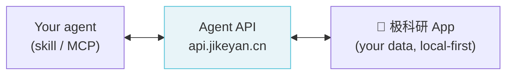
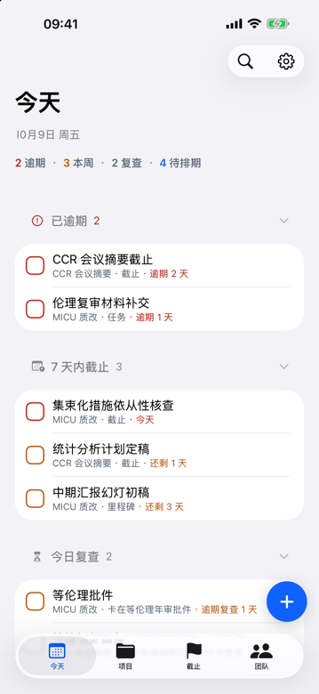
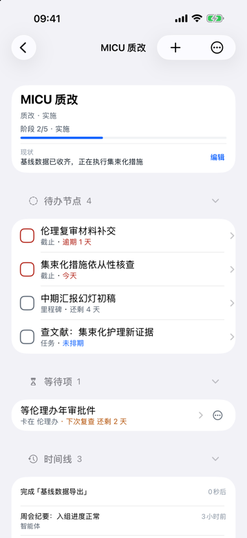
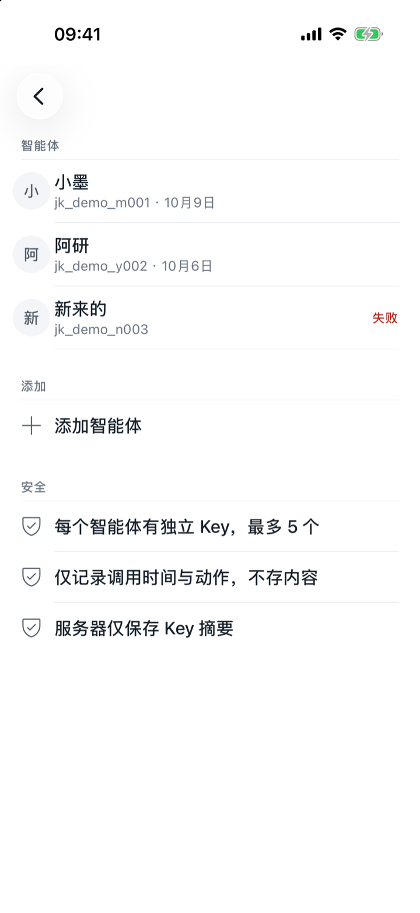

<p align="center">
  
</p>

<h1 align="center">jikeyan-agent-skill</h1>

<p align="center">
  Give your AI agent a research dashboard: projects, deadlines, waiting items, submissions, reviews.
  <br />
  让 AI 智能体替你管课题、盯截止、跟等待项——科研项目管理，一句话直达。
  <br />
  <a href="https://jikeyan.cn">Website</a> ·
  <a href="https://apps.apple.com/app/id6785017540">App Store</a> ·
  <a href="https://api.jikeyan.cn/agent.md">Agent guide</a> ·
  <a href="README.zh-CN.md">中文</a>
</p>

<p align="center">
  <a href="LICENSE"></a>
  <a href="mcp/README.md"></a>
  <a href="plugins/jikeyan/skills/jikeyan-agent/SKILL.md"></a>
  <a href="plugins/jikeyan/skills/jikeyan-agent/SKILL.md"></a>
</p>

> Official agent skills + MCP server for [极科研 (jikeyan)](https://jikeyan.cn), a local-first iOS
> kanban app for research project management. Two installable skills and a standalone MCP server,
> all speaking to the same documented Agent API ([online guide](https://api.jikeyan.cn/agent.md)).
> **中文说明见 [README.zh-CN.md](README.zh-CN.md)**（含国内 agent 平台配置：CodeBuddy、Qwen Code、通义灵码、百炼、Trae、Coze 等）。

## How it works



Your data stays on your device and the 极科研 backend in China (`api.jikeyan.cn`, no proxy needed).
The agent only sees what your Agent Key permits (read-only or project-scoped), and drafts — never sends —
follow-ups on your behalf.

## Screenshots

<p align="center">
  
  
  
  <br />
  <em>Today · Project · Connect agent — all shots use built-in demo data, no real projects.</em>
</p>

## What your agent can do

| Ask your agent to… | What happens under the hood |
|---|---|
| ☀️ Brief me this morning | Overdue nodes, items due in 7 days, waiting items to re-check today, last 48h of updates (`get_today` + daily-review workflow) |
| ⏳ Chase what's stuck | Find stalled "waiting on someone" items and draft bilingual follow-up messages (you send them; the agent never contacts anyone) |
| 📦 Import my projects | Create projects idempotently via your own `external_ref`, then add nodes in one versioned patch |
| 📝 Split reviewer comments | Break review comments into numbered actions, draft a point-by-point response letter, record the round (`add_review_round`) |
| ✅ Pre-submission check | Journal requirements, ethics, authorship, references, figures, cover letter — one item at a time |
| 📅 Count down to a deadline | Plan backwards from a hard date with buffers for external feedback and co-author confirmation |
| 🔍 Verify references & screen topics | Check BibTeX metadata against Crossref/PubMed; screen ClinicalTrials.gov + PubMed reviews (runs locally, never touches the jikeyan server) |
| 🔄 Weekly review | What got done, what's due next, what's stalled, what needs your decision |

### What the first conversation looks like

The agent greets you with a live summary of your board (demo data below — not real projects),
then waits for your pick. No endpoints, no keys, just the work:

> **Agent:** Hi! I've taken over your Jikeyan project board, and every change will show
> up on your phone. You have 3 active projects, 1 of them overdue and worth tackling
> first, plus 2 waiting items due for a follow-up today. Where should we start?
> I can update stages and deadlines, chase ethics approvals and collaborator replies,
> log submissions and review rounds — for example:
> ① add your breast-cancer prognosis study (first draft due next Friday),
> ② check what's waiting on replies today, ③ log the major-revision round that just came back.
>
> **You:** Let's do ② — what's waiting on replies today?
>
> **Agent:** Two things: the ethics approval has been with the committee for 12 days
> (I drafted a polite chase note — say the word and I'll finalize the wording for you
> to send), and Dr. Li's pathology feedback was due yesterday. Want me to set both
> to re-check tomorrow morning?
>
> **You:** Yes, and log the major revision as round two while you're at it.
>
> **Agent:** Done — both waiting items will resurface in tomorrow's brief, and round two
> is logged with a response deadline 4 weeks out. Anything else to push forward today?

## Quickstart

**1. Generate a key** — in the 极科研 app: **设置 → 连接智能体** (Settings → Connect Agent).

**2. Export it** — the key lives only in your environment, never in a repo:

```bash
export JIKEYAN_AGENT_KEY='<your agent key>'
```

**3. Install the skill or the MCP server** — pick one row, details in `<details>` below:

| Client | Skill | MCP server |
|---|---|---|
| Claude Code | `/plugin marketplace add 871922384/jikeyan-agent-skill` then `/plugin install jikeyan@jikeyan` | `.mcp.json` snippet |
| Codex | copy `plugins/jikeyan/skills/*` to `~/.codex/skills/` | `codex mcp add …` snippet |
| Cursor / Windsurf / other MCP clients | copy `plugins/jikeyan/skills/*` to the client's skills dir | generic stdio config |

Then ask your agent to "use the jikeyan skill and run `get_schema` first".

<details>
<summary><strong>Claude Code</strong></summary>

Skill (recommended):

```bash
/plugin marketplace add 871922384/jikeyan-agent-skill
/plugin install jikeyan@jikeyan
```

Portable fallback: copy `plugins/jikeyan/skills/*` to `~/.claude/skills/`.

MCP server (`.mcp.json`, project-level — keep uncommitted if it holds your key):

```json
{
  "mcpServers": {
    "jikeyan": {
      "command": "uvx",
      "args": ["jikeyan-mcp"],
      "env": {
        "JIKEYAN_AGENT_KEY": "${JIKEYAN_AGENT_KEY}",
        "JIKEYAN_API_BASE_URL": "https://api.jikeyan.cn"
      }
    }
  }
}
```

</details>

<details>
<summary><strong>Codex</strong></summary>

Skill: copy `plugins/jikeyan/skills/*` to `~/.codex/skills/`.

MCP server:

```bash
codex mcp add jikeyan \
  --env JIKEYAN_AGENT_KEY="$JIKEYAN_AGENT_KEY" \
  --env JIKEYAN_API_BASE_URL=https://api.jikeyan.cn \
  -- uvx jikeyan-mcp
```

</details>

<details>
<summary><strong>Cursor / Windsurf / Gemini CLI / other MCP clients</strong></summary>

Add a stdio server with command `uvx`, args `["jikeyan-mcp"]`, and environment variables
`JIKEYAN_AGENT_KEY` + `JIKEYAN_API_BASE_URL=https://api.jikeyan.cn`.
Or copy `plugins/jikeyan/skills/*` to the client's skills directory.

`uvx jikeyan-mcp` needs the `jikeyan-mcp` package on PyPI; until then:

```bash
uvx --from "jikeyan-mcp @ git+https://github.com/871922384/jikeyan-agent-skill#subdirectory=mcp" jikeyan-mcp
```

Plain-HTTP alternative (no MCP): `plugins/jikeyan/skills/jikeyan-agent/scripts/jikeyan.sh`
is a curl wrapper around the same API — `JIKEYAN_AGENT_KEY` + `get/post/patch`.

</details>

<details>
<summary><strong>China: domestic agents & mirrors （国内平台）</strong></summary>

Full copy-paste configs live in [README.zh-CN.md](README.zh-CN.md#在国内-agent-中使用) —
CodeBuddy & WorkBuddy （腾讯）, Qwen Code CLI, 通义灵码/Qoder, 百炼智能体应用， Trae, 扣子 Coze,
ModelScope MCP 广场， Kimi & 智谱托管智能体（远程 MCP）。

Mainland mirrors (PyPI is otherwise slow; the API itself needs no proxy):

```bash
# uv / pip via Tsinghua or Aliyun mirror
export UV_INDEX_URL='https://pypi.tuna.tsinghua.edu.cn/simple'
pip install -i https://pypi.tuna.tsinghua.edu.cn/simple jikeyan-mcp
# or: https://mirrors.aliyun.com/pypi/simple/
```

</details>

## Contents

| Path | What it is |
|---|---|
| `plugins/jikeyan/skills/jikeyan-agent/` | Skill: Agent API cookbook + `jikeyan.sh` curl wrapper + endpoint table |
| `plugins/jikeyan/skills/jikeyan-academic-colleague/` | Skill: research-management workflows (daily/weekly review, stalled detection, waiting-item follow-up, review response, pre-submission, backward planning) |
| `mcp/` | Standalone Python package `jikeyan-mcp` (17 MCP tools, stdio). See [mcp/README.md](mcp/README.md) |
| `assets/` | Logo, App screenshots (demo data only), social preview image |
| `.claude-plugin/marketplace.json` | Claude Code plugin marketplace manifest |
| `server.json` | Official MCP Registry manifest (prepared, not yet submitted) |
| `smithery.yaml` | Smithery deploy config (prepared, not yet submitted) |
| `llms.txt` | LLM-readable repo summary |
| `docs/distribution.md` | Format sources, repo metadata, manual submission checklist, China listing tracker |

## Security & privacy

- The Agent Key is read from the environment (`JIKEYAN_AGENT_KEY`) only. Never hard-code it, never commit it, never paste it into chat logs.
- **Never send patient names, hospital IDs, diagnoses, or follow-up text.** The API has no fields for them and rejects unknown fields — keep it that way. Personal notes stay on your device and are never synced.
- The MCP server runs on your own machine; it logs only tool names and HTTP status codes — no keys, no content.
- Key permissions (read-only, project-scoped) are enforced server-side. A revoked key returns `401`: regenerate it in the app.

## Links

- 极科研： [https://jikeyan.cn](https://jikeyan.cn) · [App Store](https://apps.apple.com/app/id6785017540) · [Privacy](https://jikeyan.cn/privacy)
- Agent API online guide: [https://api.jikeyan.cn/agent.md](https://api.jikeyan.cn/agent.md)
- MCP package: [mcp/README.md](mcp/README.md)

## License

MIT, see [LICENSE](LICENSE).
