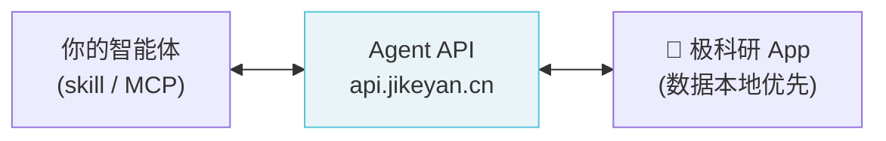
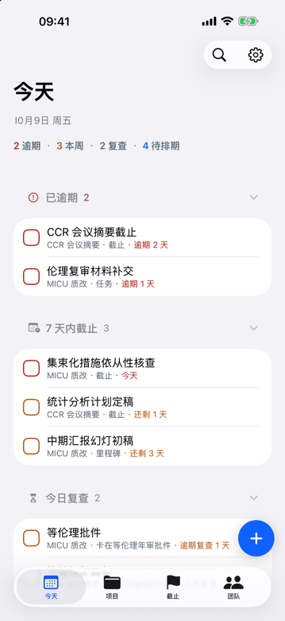
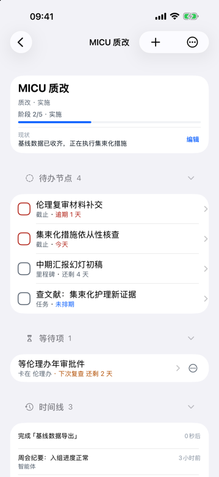
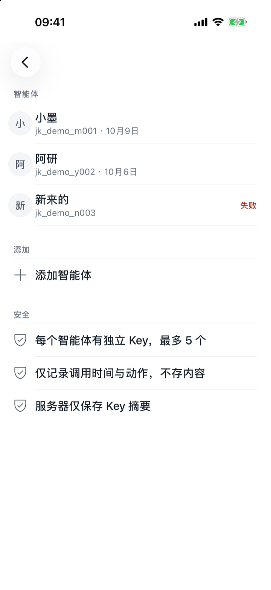

<p align="center">
  
</p>

<h1 align="center">极科研智能体技能 jikeyan-agent-skill</h1>

<p align="center">
  让 AI 智能体帮你做科研项目管理：项目进度、投稿、审稿回复、等待项跟进，一句话直达。
  <br />
  Give your AI agent a research dashboard: projects, deadlines, waiting items, submissions, reviews.
  <br />
  <a href="https://jikeyan.cn">官网</a> ·
  <a href="https://apps.apple.com/app/id6785017540">App Store</a> ·
  <a href="https://api.jikeyan.cn/agent.md">智能体接入指南</a> ·
  <a href="README.md">English</a>
</p>

<p align="center">
  <a href="LICENSE"></a>
  <a href="mcp/README.md"></a>
  <a href="plugins/jikeyan/skills/jikeyan-agent/SKILL.md"></a>
  <a href="plugins/jikeyan/skills/jikeyan-agent/SKILL.md"></a>
</p>

> **[极科研 (jikeyan)](https://jikeyan.cn) 官方智能体 Skill + MCP 服务**：本地优先的 iOS 科研看板 App，
> 搭配两个可安装 skill 与一个独立 MCP 服务，让你的智能体（Claude Code、Codex、Qwen、Trae、CodeBuddy 等）
> 管理项目进度、节点、等待项、投稿与审稿。调用同一份公开 Agent API（[在线指南](https://api.jikeyan.cn/agent.md)）。
> 服务端 `api.jikeyan.cn` 本身在国内，**无需代理**；GitHub 访问慢时的替代办法见下方“三步上手”。

## 它是怎么工作的



你的数据留在设备与国内服务端。智能体只能看到 Agent Key 允许的范围（支持只读、限定项目），
跟进话术只起草、不代发，发送永远由你完成。

## 产品截图

<p align="center">
  
  
  
  <br />
  <em>今天页 · 项目页 · 连接智能体——均为内置演示数据截图，不含真实项目与个人信息。</em>
</p>

## 你的智能体能帮你做什么

| 跟智能体说… | 背后调用 |
|---|---|
| ☀️ 今天有哪些要紧事 | 逾期节点、7 天内截止、今天该复查的等待项、最近 48 小时进展（`get_today` + 每日复盘工作流） |
| ⏳ 哪些事项卡住了 | 找出停滞的“等别人”事项，起草中英文跟进话术（只起草、不代发） |
| 📦 把这些项目导进来 | 用你自己的 `external_ref` 幂等建项目，一次 patch 写完所有节点 |
| 📝 审稿意见帮我拆一下 | 把审稿意见拆成编号事项，起草逐条回复信，记录审稿轮次（`add_review_round`） |
| ✅ 投稿前帮我检查一遍 | 期刊要求、伦理、作者、参考文献、图表、cover letter，逐项核对 |
| 📅 这个截止倒排一下 | 从硬性截止倒推，预留外部反馈与合作者确认的缓冲 |
| 🔍 文献信息对一下、有没有撞题 | 用 Crossref / PubMed 核对 BibTeX，用 ClinicalTrials.gov + PubMed 综述做选题检索（本机运行，不经过极科研服务端） |
| 🔄 本周复盘一下 | 本周完成、下周截止、停滞项、需要你拍板的事项 |

### 第一次对话长这样

智能体先用看板的实时情况跟你打招呼（下面是演示数据，不是真实项目），
然后等你挑。不念接口、不提密钥，只聊事情本身：

> **智能体：** 你好，我已经接手你的极科研看板，改动会同步到你的手机上。
> 目前手头有 3 个项目，其中 1 项已经逾期、需要优先处理，
> 今天还有 2 件在等的事该问一下了。今天我们先从哪一项开始推进？
> 我可以帮你更新阶段和截止、跟进伦理审批和合作方回复、记录投稿和审稿轮次——比如：
> ① 把那篇乳腺癌预后项目加进看板（下周五前要交初稿），
> ② 看一下今天有哪几件事在等回复，③ 把刚回来的大修意见记成第二轮审稿。
>
> **你：** 先看第 ② 项吧，今天在等哪些回复？
>
> **智能体：** 有两件：伦理批件已经在委员会那儿放了 12 天（我起草了一版得体的催问话术，
> 你点头我就定稿、由你发出），李医生的病理反馈昨天就该给了。要不要两件都设成明天
> 早上再复查？
>
> **你：** 好，顺手把大修记成第二轮吧。
>
> **智能体：** 都办好了——两件等待项会出现在明天早上的简报里，第二轮审稿也已记录，
> 回复期限按 4 周排好。今天还有哪一项要推进？

## 三步上手

**1. 生成 key**——在极科研 App：**设置 → 连接智能体**，生成 Agent Key。

**2. 设环境变量**——key 只放环境变量，绝不进仓库：

```bash
export JIKEYAN_AGENT_KEY='<你的 agent key>'
```

**3. 安装 skill 或 MCP 服务**——选一行，细节在下方折叠块里：

| 客户端 | Skill | MCP 服务 |
|---|---|---|
| Claude Code | `/plugin marketplace add 871922384/jikeyan-agent-skill` 后 `/plugin install jikeyan@jikeyan`（或把 `plugins/jikeyan/skills/*` 拷到 `~/.claude/skills/`） | 下方 `.mcp.json` 片段 |
| Codex | 把 `plugins/jikeyan/skills/*` 拷到 `~/.codex/skills/` | 下方 `codex mcp add …` 片段 |
| Cursor / Windsurf / 其他 MCP 客户端 | 把 `plugins/jikeyan/skills/*` 拷到对应 skills 目录 | 通用 stdio 配置见下方 |
| 国内 agent（CodeBuddy、Qwen Code、Trae、灵码…） | 见“[在国内 agent 中使用](#在国内-agent-中使用)” | 同左 |

装好后跟 agent 说“用 jikeyan skill，先调 `get_schema`”。

### 国内可访问性：镜像与代理说明

- `api.jikeyan.cn` 服务器在国内，**调接口无需代理、无需镜像**。
- 慢的是 PyPI（`uvx` 拉包）与 GitHub（拉仓库）。PyPI 发布前不走 PyPI，
  用 git 方式或 GHCR 镜像（见下方 MCP 配置片段）。PyPI 发布后国内这样写：

```bash
# uv / pip 走清华或阿里云镜像（二选一）
export UV_INDEX_URL='https://pypi.tuna.tsinghua.edu.cn/simple'
pip install -i https://pypi.tuna.tsinghua.edu.cn/simple jikeyan-mcp
# 备用：https://mirrors.aliyun.com/pypi/simple/
```

```bash
# GitHub 访问慢：先用镜像把仓库拉下来，再本地安装 skill
# （示例，请按你实际可用的镜像站替换）
git clone https://github.com/871922384/jikeyan-agent-skill.git
cp -r jikeyan-agent-skill/plugins/jikeyan/skills/* ~/.claude/skills/
```

### MCP 配置片段

Claude Code `.mcp.json`（项目级；若含 key 请不要提交；无需 PyPI）：

```json
{
  "mcpServers": {
    "jikeyan": {
      "command": "uvx",
      "args": [
        "--from",
        "git+https://github.com/871922384/jikeyan-agent-skill#subdirectory=mcp",
        "jikeyan-mcp"
      ],
      "env": {
        "JIKEYAN_AGENT_KEY": "${JIKEYAN_AGENT_KEY}",
        "JIKEYAN_API_BASE_URL": "https://api.jikeyan.cn"
      }
    }
  }
}
```

Docker 备选（无需本地 Python，tag 见 `server.json`，`latest` 也可）：

```json
{
  "mcpServers": {
    "jikeyan": {
      "command": "docker",
      "args": [
        "run",
        "-i",
        "--rm",
        "-e",
        "JIKEYAN_AGENT_KEY",
        "-e",
        "JIKEYAN_API_BASE_URL=https://api.jikeyan.cn",
        "ghcr.io/871922384/jikeyan-mcp:latest"
      ]
    }
  }
}
```

Codex：

```bash
codex mcp add jikeyan \
  --env JIKEYAN_AGENT_KEY="$JIKEYAN_AGENT_KEY" \
  --env JIKEYAN_API_BASE_URL=https://api.jikeyan.cn \
  -- uvx --from "git+https://github.com/871922384/jikeyan-agent-skill#subdirectory=mcp" jikeyan-mcp
```

Docker 备选：

```bash
codex mcp add jikeyan \
  -- docker run -i --rm -e JIKEYAN_AGENT_KEY -e JIKEYAN_API_BASE_URL=https://api.jikeyan.cn ghcr.io/871922384/jikeyan-mcp:latest
```

其他客户端（Cursor、Windsurf、Gemini CLI……）：添加 stdio 服务，
二选一（git 方式需 Python 3.11+，Docker 方式无需本地 Python）：

```bash
uvx --from "git+https://github.com/871922384/jikeyan-agent-skill#subdirectory=mcp" jikeyan-mcp
```

```bash
docker run -i --rm -e JIKEYAN_AGENT_KEY ghcr.io/871922384/jikeyan-mcp:latest
```

不用 MCP 也行：`plugins/jikeyan/skills/jikeyan-agent/scripts/jikeyan.sh`
是同 API 的 curl 封装——`JIKEYAN_AGENT_KEY` + `get/post/patch`。

## 在国内 agent 中使用

> 以下结论均 2026-11-18 联网查官方文档核实，出处附链接；查不到的如实标“未核实”，请勿当作承诺。
> 能跑本机 stdio 的平台直接照抄；**只支持远程 MCP 的平台**（扣子、Kimi/智谱托管智能体、百炼 Flow）
> 需要先有一个公网 MCP 端点，现状与托管选项见 [docs/distribution.md](docs/distribution.md)（本仓库不部署任何服务）。
>
> ⚠️ PyPI 发布前注意：以下各节凡写 `"args": ["jikeyan-mcp"]`（或 `uvx jikeyan-mcp`）的，
> 请把 `args` 换成下面二选一（git 方式需 Python 3.11+；Docker 方式无需本地 Python，
> `latest` 可换成 `server.json` 里 pin 的版本 tag）：
>
> ```json
> "args": ["--from", "git+https://github.com/871922384/jikeyan-agent-skill#subdirectory=mcp", "jikeyan-mcp"]
> ```
>
> ```json
> "command": "docker",
> "args": ["run", "-i", "--rm", "-e", "JIKEYAN_AGENT_KEY", "ghcr.io/871922384/jikeyan-mcp:latest"]
> ```

<details>
<summary><strong>腾讯 CodeBuddy（IDE + CLI）✅ Skill + MCP（stdio/远程）</strong></summary>

Skill：项目级 `.codebuddy/skills/jikeyan-agent/SKILL.md`，或用户级 `~/.codebuddy/skills/`。
直接复制本仓库 skill 目录即可：

```bash
mkdir -p .codebuddy/skills ~/.codebuddy/skills
cp -r plugins/jikeyan/skills/jikeyan-agent .codebuddy/skills/
cp -r plugins/jikeyan/skills/jikeyan-academic-colleague .codebuddy/skills/
```

或 IDE 设置 → Skills → 导入 Skill；CLI 用 `npx skills add 871922384/jikeyan-agent-skill`。

MCP（`~/.codebuddy/.mcp.json` 用户级，或项目根 `.mcp.json`）：

```json
{
  "mcpServers": {
    "jikeyan": {
      "type": "stdio",
      "command": "uvx",
      "args": ["jikeyan-mcp"],
      "env": {
        "JIKEYAN_AGENT_KEY": "${JIKEYAN_AGENT_KEY}",
        "JIKEYAN_API_BASE_URL": "https://api.jikeyan.cn"
      }
    }
  }
}
```

CLI 命令：`codebuddy mcp add --scope user jikeyan -- uvx jikeyan-mcp`。

出处：<https://www.codebuddy.ai/docs/zh/cli/skills>、
<https://www.codebuddy.ai/docs/zh/cli/mcp>、
<https://www.codebuddy.ai/docs/zh/cli/codebuddy-dir>（访问日期 2026-11-18）。

</details>

<details>
<summary><strong>腾讯 WorkBuddy（桌面智能体）✅ Skill + MCP（stdio/远程）</strong></summary>

Skill：左侧「专家·技能·连接器」→ 添加技能 → 上传本地技能包（zip，根目录含 `SKILL.md`），或：

```bash
# 打包本仓库 skill 后在 WorkBuddy 里上传
zip -r jikeyan-agent.zip plugins/jikeyan/skills/jikeyan-agent
```

MCP：用户级 `~/.workbuddy/mcp.json`（所有项目复用），或项目级 `.workbuddy/mcp.json`：

```json
{
  "mcpServers": {
    "jikeyan": {
      "command": "uvx",
      "args": ["jikeyan-mcp"],
      "env": {
        "JIKEYAN_AGENT_KEY": "你的 agent key",
        "JIKEYAN_API_BASE_URL": "https://api.jikeyan.cn"
      }
    }
  }
}
```

skills 默认目录官方未给绝对路径（第三方教程称 `~/.workbuddy/skills/<name>/SKILL.md`，未核实），建议走界面上传。

出处：<https://www.workbuddy.cn/docs/workbuddy/From-Beginner-to-Expert-Guide/Function-Description/MCP-Guide>、
<https://www.workbuddy.ai/docs/zh/workbuddy/From-Beginner-to-Expert-Guide/Function-Description/Skills>（访问日期 2026-11-18）。

</details>

<details>
<summary><strong>Qwen Code CLI ✅ Skill + MCP（stdio/远程）</strong></summary>

Skill（三处任选其一）：

```bash
mkdir -p ~/.qwen/skills   # 个人级；项目级用 .qwen/skills/ 或 .agents/skills/
cp -r plugins/jikeyan/skills/jikeyan-agent ~/.qwen/skills/
cp -r plugins/jikeyan/skills/jikeyan-academic-colleague ~/.qwen/skills/
```

MCP（`~/.qwen/settings.json` 用户域，或项目根 `.qwen/settings.json`，`qwen mcp add` 默认写用户域）：

```json
{
  "mcpServers": {
    "jikeyan": {
      "command": "uvx",
      "args": ["jikeyan-mcp"],
      "env": {
        "JIKEYAN_AGENT_KEY": "$JIKEYAN_AGENT_KEY",
        "JIKEYAN_API_BASE_URL": "https://api.jikeyan.cn"
      }
    }
  }
}
```

远程形态用 `url`（SSE）或 `httpUrl`（Streamable HTTP），三者优先级 `httpUrl > url > command`。
快捷命令：`qwen mcp add --scope project -e JIKEYAN_AGENT_KEY=$JIKEYAN_AGENT_KEY jikeyan uvx jikeyan-mcp`。

出处：<https://qwenlm.github.io/qwen-code-docs/zh/users/features/skills/>、
<https://qwenlm.github.io/qwen-code-docs/zh/users/features/mcp/>（访问日期 2026-11-18）。

</details>

<details>
<summary><strong>通义灵码（现 Qoder CN）✅ Skill + MCP（stdio/SSE，独立 IDE 已核实）</strong></summary>

Skill（独立 IDE / Lingma IDE；旧 VS Code、JetBrains 插件端支持程度未核实）：

```bash
mkdir -p ~/.lingma/skills   # 用户级；项目级用 .lingma/skills/
cp -r plugins/jikeyan/skills/jikeyan-agent ~/.lingma/skills/
cp -r plugins/jikeyan/skills/jikeyan-academic-colleague ~/.lingma/skills/
```

也可用内置 `/create-skill` 生成器，或 v0.4.0+ 的 `.agents/skills/` 目录。模型按 skill 描述自动触发，或 `/skill-name` 手动触发。

MCP：IDE 内「个人设置 → MCP 服务」手工添加（填命令 `uvx`、参数 `jikeyan-mcp`、环境变量），
或“配置文件添加”粘贴：

```json
{
  "mcpServers": {
    "jikeyan": { "command": "uvx", "args": ["jikeyan-mcp"] }
  }
}
```

约束：仅智能体模式可用（配 qwen3 模型），最多同时连 10 个 MCP 服务；远端只核实了 SSE，Streamable HTTP 未核实。

出处：<https://help.aliyun.com/zh/lingma/user-guide/guide-for-using-mcp>、
<https://help.aliyun.com/zh/lingma/skills-3020747>（访问日期 2026-11-18）。

</details>

<details>
<summary><strong>阿里云百炼智能体应用 ✅ Skill + MCP（自定义需托管，见说明）</strong></summary>

Skill：控制台「组件 Skill 管理 → 自定义 Skill」上传 zip（根目录必须有 `SKILL.md`、≤10MB，
frontmatter 只需 `name` + `description`，description 写清触发条件）。自动审查约 2 分钟。

MCP：智能体应用最多同时加 5 个 MCP 服务。**控制台内不能直接挂你笔记本上的本地进程**，
两条路（二选一）：

1. 脚本部署：把 `jikeyan-mcp` 的 stdio 包部署到函数计算 FC（`npx`/`uvx` 形态，基础模式按调用时长计费），
   再挂到智能体；
2. 纯注册：先把 MCP 服务暴露为公网 URL（自有服务器/网关），再用 `http` 方式只登记端点（不产生部署费）：

```json
{
  "mcpServers": {
    "jikeyan": {
      "type": "streamableHttp",
      "url": "https://你的域名/mcp",
      "headers": { "Authorization": "Bearer ${DASHSCOPE_API_KEY}" }
    }
  }
}
```

托管方案的工作量与费用见 [docs/distribution.md](docs/distribution.md)。

出处：<https://help.aliyun.com/zh/model-studio/introduction-to-skill>、
<https://help.aliyun.com/zh/model-studio/custom-mcp>、
<https://help.aliyun.com/zh/model-studio/official-and-third-party-mcp>（访问日期 2026-11-18）。

</details>

<details>
<summary><strong>字节 Trae（AI IDE）✅ Skill + MCP（stdio/HTTP）</strong></summary>

Skill：全局 `~/.trae/skills/`（国内版 `~/.trae-cn/skills/`），项目级 `.trae/skills/`，
也兼容 `.agents/skills/`（需开启对应开关）：

```bash
mkdir -p ~/.trae-cn/skills   # 国际版用 ~/.trae/skills
cp -r plugins/jikeyan/skills/jikeyan-agent ~/.trae-cn/skills/
cp -r plugins/jikeyan/skills/jikeyan-academic-colleague ~/.trae-cn/skills/
```

每个 skill = `SKILL.md`（`name`/`description` frontmatter 必填）+ 可选 `examples/` 等。

MCP（内置市场添加，或全局/项目级 `.trae/mcp.json`）：

```json
{
  "mcpServers": {
    "jikeyan": {
      "command": "uvx",
      "args": ["jikeyan-mcp"],
      "env": {
        "JIKEYAN_AGENT_KEY": "你的 agent key",
        "JIKEYAN_API_BASE_URL": "https://api.jikeyan.cn"
      }
    }
  }
}
```

向 Trae 市场公开上架的入口与审核要求：未核实。

出处：<https://docs.trae.ai/ide/add-mcp-servers?_lang=zh>、
<https://docs.trae.ai/ide/skills?_lang=zh>（访问日期 2026-11-18）。

</details>

<details>
<summary><strong>扣子 Coze（coze.cn）⚠️ 仅远程 MCP + Skill（对话侧）</strong></summary>

Coze 不支持 stdio 本地进程，只支持远程 Streamable HTTP / SSE。本机 `jikeyan-mcp`
需要先托管为公网 MCP 端点（方案见 [docs/distribution.md](docs/distribution.md)），再用 MCP JSON 粘贴添加：

```json
{
  "mcpServers": {
    "jikeyan": { "url": "https://你的域名/mcp" }
  }
}
```

约束：插件 URL 必须为 HTTPS 域名（不支持裸 IP）；每个 Agent 建议最多 10 个 MCP。
Skill：`SKILL.md` 必选，可上传 `.skill`/`.zip`，但部署好的技能目前**仅支持在扣子对话中使用**，
扣子编程开发的智能体/工作流/应用暂不支持调用技能。

出处：<https://docs.coze.cn/mcp>、
<https://docs.coze.cn/guides_skill_overview>（访问日期 2026-11-18）。

</details>

<details>
<summary><strong>魔搭 ModelScope MCP 广场 ✅ 可托管部署 / 仅本地展示</strong></summary>

本仓库的 MCP 包形态（`uvx jikeyan-mcp` + PyPI 包）正好符合魔搭“可托管部署”链路：
PyPI 发包后在 `https://modelscope.cn/mcp/servers/create?template=customize` 创建，
填中英文名称、仓库地址、MCP 配置与环境变量、README，平台自动托管并给出专属 SSE URL，
通义灵码、Kimi Playground 等可一键接入。不能托管就选“仅本地可用”做展示。
企业认证要求：未核实（官方只要求注册登录 + 访问令牌）。

Kimi 托管智能体同步魔搭 MCP 后，用 `mcp_servers: [{"type": "url", "name": "jikeyan", "url": "<魔搭专属SSE地址>"}]` 引用。

出处：<https://www.modelscope.cn/docs/mcp/intro>、
<https://modelscope.cn/docs/mcp/lingma>（访问日期 2026-11-18）。

</details>

<details>
<summary><strong>Kimi / 智谱托管智能体 ⚠️ 仅远程 MCP + Skill API</strong></summary>

两家云端 Agent 都只接受公网 Streamable HTTP（`type: "url"`）的 MCP，本地 stdio 跑不了。
先托管出公网端点（方案见 [docs/distribution.md](docs/distribution.md)），再声明：

```json
{ "mcp_servers": [{ "type": "url", "name": "jikeyan", "url": "https://你的域名/mcp" }] }
```

Skill 走开放平台 API 上传（含顶层 `SKILL.md` 的目录/zip 包），挂到 Agent 引用。
向两家市场公开发布的上架入口与材料：未核实。

出处：<https://platform.kimi.com/docs/hosted-agents/mcp>、
<https://docs.bigmodel.cn/cn/managed-agents/mcp>（访问日期 2026-11-18）。

</details>

<details>
<summary><strong>腾讯云 MCP 广场 ❌ 暂不接受第三方上架 · 本地 stdio 可用</strong></summary>

腾讯云 MCP 广场的 MCP 均为官方/合作服务，官方明确“针对第三方 MCP 产品，目前暂不提供上架与更新服务”，
所以 jikeyan 无法上架到该广场。但广场文档里的本地（Local）消费形态就是 stdio，
你仍可在任何支持 stdio 的客户端里用 git 方式或 GHCR 镜像（配置同 CodeBuddy 一节，`args` 替换见本节开头说明）。

出处：<https://cloud.tencent.com/developer/mcp>、
<https://cloud.tencent.com/document/product/1212/123193>（访问日期 2026-11-18）。

</details>

## 目录

| 路径 | 内容 |
|---|---|
| `plugins/jikeyan/skills/jikeyan-agent/` | Skill：Agent API 操作手册 + `jikeyan.sh` + 端点表 |
| `plugins/jikeyan/skills/jikeyan-academic-colleague/` | Skill：科研管理工作流（每日/每周复盘、停滞判断、等待项跟进、审稿回复、投稿前检查、倒排计划） |
| `mcp/` | 独立 Python 包 `jikeyan-mcp`（17 个 MCP 工具，stdio），见 [mcp/README.md](mcp/README.md) |
| `assets/` | 品牌 logo、App 截图（演示数据）、社交预览图 |
| `.claude-plugin/marketplace.json` | Claude Code 插件市场清单 |
| `server.json` | 官方 MCP Registry 清单（已准备好，尚未提交） |
| `smithery.yaml` | Smithery 部署配置（已准备好，尚未提交） |
| `llms.txt` | 给 LLM 检索的仓库摘要 |
| `docs/distribution.md` | 格式出处、仓库元信息建议、远程 MCP 方案、国内上架清单、社交预览图上传步骤 |

## 安全与隐私

- Agent Key 只从环境变量（`JIKEYAN_AGENT_KEY`）读取。不要写死、不要提交、不要贴到聊天记录或日志里。
- **不要向 API 发送患者姓名、住院号、诊断或随访原文**——接口本来就没有这些字段，未知字段会被拒绝。个人笔记只保存在设备端，不参与同步。
- MCP 服务跑在你自己的机器上；日志里只有工具名和 HTTP 状态码，没有 Key、没有内容。
- Key 权限（只读、限定项目范围）由服务端强制执行。Key 被撤销会返回 `401`，去 App 里重新生成即可。

## 链接

- 极科研：[https://jikeyan.cn](https://jikeyan.cn) · [App Store](https://apps.apple.com/app/id6785017540) · [隐私政策](https://jikeyan.cn/privacy)
- Agent API 在线指南：[https://api.jikeyan.cn/agent.md](https://api.jikeyan.cn/agent.md)
- MCP 包说明：[mcp/README.md](mcp/README.md)

## 协议

MIT，见 [LICENSE](LICENSE).
